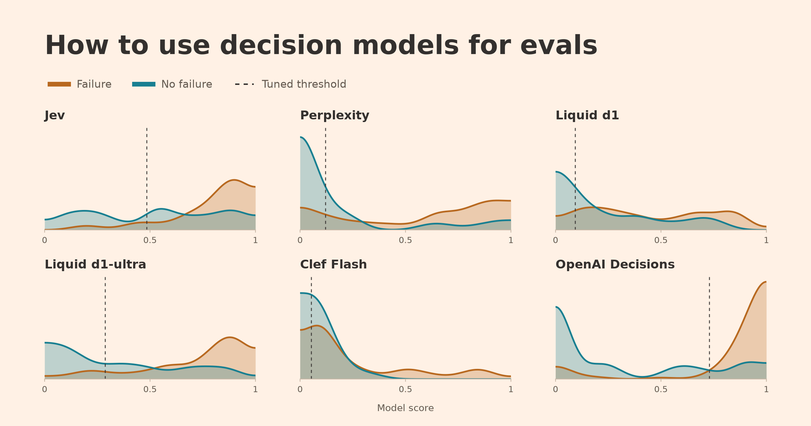

# 如何用决策模型做评测：阈值调优、成本对照与概率校准

> 原文：[How To Use Decision Models for Evals](https://hamel.dev/blog/posts/decision-model-evals/) · Hamel's Blog · Hamel Husain、Antaripa Saha · 2026-10-20（X 长文为[同文镜像](https://x.com/HamelHusain/status/2112588257104216294)）
>
> 译文为社区学习用途的非官方中文翻译，版权归原作者所有。



## 作者与来源

**Hamel Husain**，机器学习工程师，20 余年经验，曾任职 Airbnb 与 GitHub（其早期 LLM 研究被 OpenAI 用于代码理解），multiple 热门开源 ML 工具的贡献者；近年专注 AI 评测（evals）教学，X 简介就是 "Evals Evals Evals @OpenAI"。合著者 **Antaripa Saha**。发布于 hamel.dev 博客，X 上的长文版本为同一篇。

**证据分级**：独立第三方实测（非厂商）。实验设计相当扎实——数据集冻结、人工标注 + 两个评测平台交叉补充、五折交叉验证、阈值选择审计记录公开、校准结果 JSON 可下载。所有数字仍是这一份实验的自报，但**方法与原始数据全部公开可复算**，证据强度显著高于厂商发布文。

## 正文（全译）

决策模型最近井喷：始于 TypeSafe 的 Jev，随后是 Perplexity 的 Decider、Liquid 的 d1、Cloudflare 的 Clef、OpenAI 的 Decisions API。它们承诺快速、廉价的分类。

决策模型是 LLM 评审（LLM judge）的一种低成本替代方案，很适合自动化评测。但它是否是正确选择，取决于你的用例对成本、性能和延迟的要求。

我们还注意到：很多人在用**默认决策阈值 0.50**，却不检查它是否适合自己的任务——这会让你白白损失大量性能。

本文先演示如何调优阈值以从决策模型获得最佳结果；阈值调好后，再对比成本与性能，帮你评估哪个模型适合你的用例；最后探讨如何解读模型分数（在决定是否行动时），以及校准（calibration）如何让分数成为更有用的置信估计。

### 我们测了什么

我们使用了来自一个**公寓租赁智能体**的 100 条轨迹（trace，即对话与动作的日志）。任务是找出包含错误的轨迹——例如预订失败或漏转向人工。我们在此前一篇自动化评测博文中用过同一数据集和同一宽泛的“找错误”任务。这里，每个决策模型为每条轨迹返回一个失败概率。

测试对象：**Jev 1.13、Perplexity Decider 1.1 27B、Liquid d1 与 d1-ultra、Cloudflare Clef Flash、OpenAI Decisions（GPT-6 Luna）**。每个模型收到相同的评测标准。附录给出评测 prompt 及 Jev 使用的结构化版本。

我们从两个维度比较：

- **性能**：把每个模型的预测与经人工复核标注为通过/失败的轨迹对比。这衡量模型抓住失败的同时避免误报的能力。
- **成本**：按 token 用量与供应商价格计算 API 成本。

为简洁起见，延迟不纳入对比——它受本实验控制范围外的因素影响。

### 理解决策阈值

每条轨迹被赋予 pass 或 fail 两类标签之一。这是**二元 pass/fail 评测**——我们推荐它，因为它促成清晰的标准，也更容易与人类偏好对齐。

每个决策模型返回一个 0 到 1 的分数，估计该轨迹包含失败的可能性。API 用**默认决策阈值 0.50** 把分数变成决策：分数达到或超过阈值的轨迹被标记为失败。不对照自己的数据检查就使用这个默认值，结果可能不佳。

例如，一个模型可能给每个失败 0.40 分、每个通过 0.10 分——尽管它在 0.30 的阈值下分类完美，默认的 0.50 将一无所获。

实践中，失败与通过轨迹的分数会重叠。降低阈值能抓到更多失败，但也会增加误报。选阈值意味着权衡：

- **精确率（precision）**：被标记轨迹中含已知失败的比例。
- **召回率（recall）**：已知失败中被模型抓住的比例。

正确的取舍取决于业务目标。例如，刑事审判为避免冤枉无辜者而设置高定罪门槛——强调精确率；癌症筛查可能强调召回率，接受更多误报以减少漏诊。本次对比给两者同等权重，用 F1 分数（二者的调和平均，0 到 1，越高越好）。

下面的曲线展示每个模型给失败（橙）与通过（蓝）打分的分布：曲线越高，越多该类分数落在那个区间。分数在虚线阈值右侧的被标记。用切换开关对比 0.50 与 **Optimized for best F1**（为每个模型选一个阈值）。

**OpenAI 在此任务上把两类分得最开**，这也反映在其更高的 F1 上。

同样重要的是：不要盲目最大化 F1 而不思考分类器可用的最低要求。例如，若这个分类器用于自动告警系统，我会要求精确率与召回率**都至少 80%**——在少误报的同时抓住足够多的失败。

下图展示精确率与召回率随阈值变化的情况，阴影区域是两者都达到 80% 的区间。Perplexity、Liquid d1-ultra 与 OpenAI Decisions 满足要求，但还需要在每个模型的阴影区内选一个决策阈值。

### 调优决策阈值

本例以 F1 为优化目标。对候选模型，我们把调优约束在训练数据上同时满足 80% 精确率与 80% 召回率的阈值内（可行时）；其余模型不设约束，以展示调优的效果。

有了标注轨迹和保存的模型分数，你可以让编程智能体来调阈值。下面是一段可按需修改的示例 prompt：

> 使用我保存的模型分数和二元标签（1 表示失败），调优决策阈值以最大化 F1，同时要求精确率与召回率至少各 80%。使用分层五折交叉验证：在训练样本上选阈值，在剩余样本上测性能。比较模型时使用相同切分。只选择在训练样本上同时满足两条最低线的阈值；若没有合格的，如实报告而不是放宽要求。报告验证集的精确率、召回率与 F1，以及任何不合格的切分。与默认阈值 0.50 对比。复用已保存的分数，不要发起新的模型调用。

F1 调优对各模型性能的改变如下。三位候选归为一组，其余模型以灰色展示调优能帮多少：

我们的候选模型从 F1 调优中获益较少；Liquid d1 和 Clef Flash 获益更大，但仍低于我们的最低线。不过，精确率与召回率的小幅移动也会影响业务成本或用户体验，所以要**刻意选择**取舍。实践中，精确率与召回率很少同等重要（本文用 F1 时假设了同等）——**F-beta 分数**允许你在 beta 低于 1 时更重精确率、高于 1 时更重召回率。优化别的指标可能导出不同的阈值与结果。

### 性能与成本

下图比较各模型调优后的 F1 与成本（聚焦剩下的候选）：

虚线是剩余候选中的**帕累托前沿**：对任意给定 F1，它标出满足或超过该分数的最便宜候选。（只有三个选项时这张图有点滑稽，但它很好地演示了成本对性能的思考方式。）

**Perplexity 是候选中最便宜的：每 100 次评测 0.82 美分，F1 0.79。OpenAI Decisions 达到 F1 0.87，每 100 次评测 3.72 美分——约 4.5 倍成本。**

### 能相信概率吗

除 pass/fail 之外，你可能还想把决策模型的分数当**置信估计**用。但那个数字能按字面理解吗？一个 0.80 的分数要意味着 80% 的失败概率，相似分数的轨迹里就该有约 80% 真的含失败。

下图展示每个模型的**概率校准**：预测概率与实际结果的吻合程度。每个点代表约 20 条分数相近的轨迹。点落在对角线上，表示预测概率与该组的失败率一致；在线上方，模型低估了失败风险；线下方，高估。

如果预测概率与实际不符，可以用另一个模型来调整。第二幅图展示一种方法——**Platt scaling**——拟合一条简单曲线来完成调整。

Perplexity、Liquid d1 和 Clef Flash 在校准后更靠近对角线。例如，Clef Flash 的一组轨迹平均预测失败概率约 **8%，实际却有 60%** 包含失败。

**Jev 和 Liquid d1-ultra 在此数据集上本来校准就很好，几乎不需要调整。**

Platt scaling 并不总是最佳选择：OpenAI 的概率在我们使用的 Platt 版本下反而略变差了。你可以让编程智能体做校准，prompt 如下：

> 使用我保存的失败概率和二元标签（1 表示失败），检验 Platt scaling 是否改善每个模型的概率。使用分层五折交叉验证、所有模型同一套切分。在每个训练切分上拟合校准映射，应用到其余轨迹。先对 log-odds 拟合，并把概率从 0 和 1 附近裁开。绘制校准前后预测概率对实际失败率的图。报告 Brier 分数（越低越好），并解释哪些模型改善、哪些变差。复用已保存的分数，不要发起新的模型调用。

### Prompt 调优与评审范围

我们把本文的评测任务保持得很宽泛，以便更容易看出模型间的差异。实践中我们建议**为每种失败模式建一个独立的评审**。任务更窄、指导更具体时，我们预期模型间的性能差距会缩小。

我的习惯是从一个在该任务上表现可接受的大模型开始，然后试更小的模型能否以更低成本达到同等性能。如果有高质量标注，prompt 调优也会有帮助——如何写好评审 prompt 见我的另一篇文章。

### 落到实践

对这个数据集而言，**OpenAI 表现突出但成本更高**。Perplexity 和 Liquid d1-ultra 是更低成本、更低性能的选项。我们观察到模型性能**在不同任务与数据集间差异巨大**——所以自己动手测量很重要。

要点回顾：

1. 对评审 prompt 满意后，为用例设定**最低精确率与召回率**要求，排除达不到的模型。
2. **比较性能前先调各模型的决策阈值**。选一个符合业务目标的精确率-召回率取舍；要有意识，别因为本文用了 F1 就跟着用 F1。
3. 想把分数当置信估计用，**先检验概率是否与实际结果吻合**。校准有帮助，但你需要测量它是否真的改善了。
4. 为你的负载权衡性能、成本与延迟。

这个过程是迭代的：改了 prompt 可能就要重新调阈值或重看校准。本文聚焦阈值调优与校准，因为我们见过太多人**开箱即用**决策模型而不考虑这些因素。

你也许会问：决策模型与 LLM 相比呢？OpenAI Decisions 用的是 GPT-6 Luna，在最高成本下给出了我们的最高 F1——这暗示更难的评测任务也许值得为 LLM 付费。在 Randy Olson 的一次更宽泛的对比中，决策模型能以更低成本在分类与路由上匹敌 LLM，而需要知识与推理的任务上 LLM 拉开差距。

本文讨论的 idea 没有一个是新的：选精确率-召回率取舍、调阈值、对比性能与成本，都是评测任何分类器的一部分。想深入这些基础，推荐 Kyle Gallatin 与 Chris Albon 的《Machine Learning with Python Cookbook, 2nd Edition》。

最后，如果你是数据科学家或 ML 工程师，正在疑惑自己在 AI 时代的位置——这些技能你早就有了。是时候**复仇**了 🙂

### 附录：评测 prompt

Perplexity、Liquid d1 与 d1-ultra、Clef Flash 和 OpenAI Decisions 收到下面的 prompt。Jev 收到等价标准的结构化 prompt（见示例）。图表用的分数与标签以 JSON 形式公开。

> 判断 `messages` 是否包含至少一个实质性失败、风险或质量问题——在 AI 助手的行为或工具使用层面。这是一条完整的生成轨迹：该 AI 通过电话或消息处理公寓租赁客服。轨迹包含对话及所有工具调用与工具输出。
>
> 评审对象是 AI 助手及其工具使用，而不是客户。把 `messages` 里的系统消息视为约束助手行为与能力边界的指令。检查完整轨迹，包括最终轮次与所有工具调用及输出。只基于轨迹内可见的证据判断。不要假设轨迹里不存在的对外政策、渠道行为或业务要求。不要假设每条轨迹都失败了。简短、模糊或无定论的轨迹不是问题，除非可见证据确立了一个实质性失败。
>
> 返回"至少存在一个实质性问题"的概率；该问题不需要被命名或归类。
>
> 计为问题的情形（需有轨迹证据支持）：助手与适用的系统指令或工具结果相矛盾；做出无依据的事实或操作断言；遗漏、误用、重复或谎称完成了必需的工具动作、转接、预订、取消、跟进或确认；实质性地误解或未解决用户的明确请求；把内部动作、占位符或损坏内容暴露给客户并实质性伤害交互。
>
> 不计为问题的情形：无实质影响的微小风格偏好；纯由客户行为导致的失败；未暴露给客户也未导致错误回应的内部工具元数据；需要轨迹之外信息的假设性担忧；证据不足或无定论的对话。

**Jev 结构化 prompt 示例**（instructions 与评测标准分开成字段）：

```json
{
  "version": "nurtureboss-any-issue-v1",
  "question_id": "has_substantive_issue",
  "type": "noul",
  "instructions": {
    "task": "Does `messages` contain at least one substantive failure, risk, or quality problem in the AI assistant's behavior or tool use?",
    "context": "This is one production trace from an AI that handles apartment-leasing customer support over phone or messaging. The trace contains the complete conversation plus any tool calls and tool outputs.",
    "evaluation_rules": [
      "Evaluate the AI assistant and its tool use, not the customer.",
      "Treat system messages inside `messages` as the instructions governing the assistant's behavior and allowed capabilities.",
      "Inspect the full trace, including the final turns and all tool calls and tool outputs.",
      "Base the judgment only on evidence visible in this trace. Do not assume external policies, channel behavior, or business requirements that are not present.",
      "Do not assume every trace failed. A short, ambiguous, or inconclusive trace is not an issue unless the visible evidence establishes a substantive failure.",
      "Return the probability that at least one substantive issue is present. The issue does not need to be named or clustered."
    ]
  },
  "criteria": {
    "true": {
      "definition": "At least one substantive problem is supported by evidence in the trace.",
      "examples_of_qualifying_evidence": [
        "The assistant contradicts an applicable system instruction or a tool result.",
        "The assistant makes an unsupported factual or operational claim.",
        "A required tool action, transfer, booking, cancellation, follow-up, or confirmation is missing, incorrect, repeated, or falsely claimed as complete.",
        "The assistant materially misunderstands or leaves an explicit user request unresolved.",
        "Customer-facing text exposes internal actions, placeholders, or broken content that materially harms the interaction."
      ]
    },
    "false": {
      "definition": "No substantive assistant problem can be established from the visible trace.",
      "do_not_count_as_an_issue": [
        "A minor stylistic preference with no meaningful effect.",
        "A failure caused only by the customer's behavior.",
        "Internal tool metadata that was not exposed to the customer and did not cause an incorrect response.",
        "A hypothetical concern that requires information outside the trace.",
        "Insufficient evidence or an inconclusive conversation."
      ]
    }
  }
}
```

---

## 译注

- **作者是谁、为什么这篇重要**：Hamel Husain 是 AI 评测领域公认的头部实践者与教学者（GitHub 时期参与被 OpenAI 采用的早期 LLM 代码理解研究，近年以 evals 课程与写作影响整个行业）。决策模型评测此前散落在厂商发布（本库 23/29/38/39/42 号）与社区实测（33 号 Arena）里，这篇是**第一份把“怎么正确评测决策模型”系统写出来的第三方方法论**：阈值调优、精确率-召回率约束、概率校准、成本对照，四步都有数据与可复算的审计记录。
- **Jev 在这份测试里不占优**——F1 掉出候选组（80/80 最低线）、Brier 0.187 未见改善。这与 23 号（Clef 发布文）、42 号（TypeSafe 自家 antibench 0.97 分）构成三方口径：**同一模型在不同任务/数据/阈值设置下排名会翻转**，任何单榜都别当福音书（作者自己也是这么写的）。同时注意延迟脚注：Jev 平均 4.33 秒、d1-ultra 1.56 秒最快——与 36 号（LLM2Jev 报的 48ms）测量口径完全不同，不可互比。
- **与 26 号（Jev Judge）的关系**：26 号展示了“用 Jev 当评审”的做法，这篇给出了它的**严谨版**——同一任务的宽窄之别（宽任务拉差距、窄任务缩差距）、每种失败模式独立建评审、以及一份可直接抄的阈值调优与校准 prompt。
- **“默认 0.5 别直接用”** 与 **39 号**（Microsoft-Decision-1 的阈值讨论）互相印证；而 **Clef Flash“预测 8% 实际 60%”** 的校准案例是全篇最惊人的数字——对照 **07 册**（box 的 confidence 会失真）与 **35 号**（proper scoring rule），“概率是不是可信的概率”应该成为决策模型验收清单的固定项。
- **翻译取舍**：交互图表无法搬进 markdown，相关读数已化入正文与表格；脚注中与数字口径直接相关的五条（版本清单、数据集构成、成本口径、延迟、校准细节）已并入正文相应位置；完整脚注与交互图表见原文。
